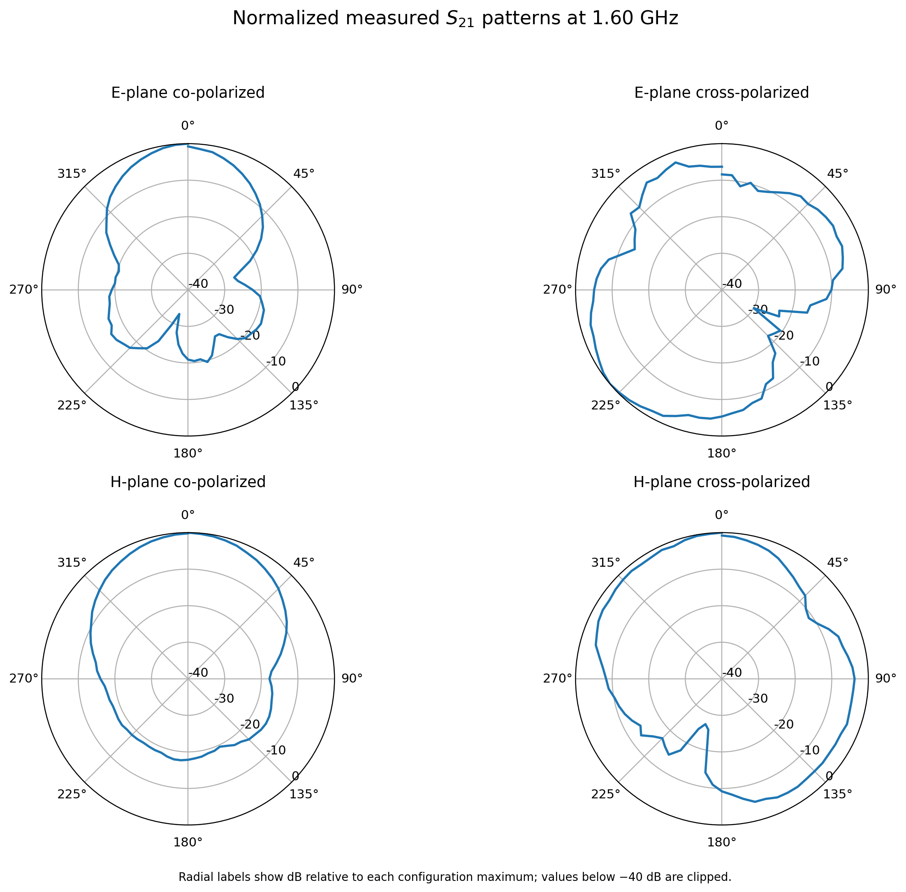
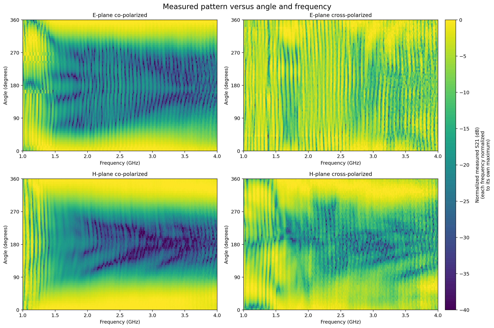

# Measuring the Power Pattern of a Horn Antenna

This project measures and analyses the power pattern of a horn antenna across the 1 to 4 GHz frequency range. Measurements were collected in an anechoic chamber using a horn antenna as the transmitter, a dipole antenna as the receiver, a vector network analyzer (VNA), and a motor controller for antenna rotation.

The analysis covers the E-plane and H-plane in co-polarized and cross-polarized configurations. This repository includes the four measured CSV datasets and a Python script that checks the data and generates polar plots, angle-frequency heatmaps, and frequency comparisons.

## My Contribution

I carried out the experiment and the post-processing represented by the measurement data and analysis code in this repository. This included working with the antenna measurement setup, collecting VNA measurements, and analysing the measured response as a function of angle and frequency. The lab report was prepared separately by my teammates.

## Experimental Setup

- The horn antenna was connected to VNA Port 1 through an amplifier.
- The receiving dipole was connected to Port 2.
- Measurements were conducted in an anechoic chamber.
- A motor controller rotated the antenna setup to collect angular measurements.
- The VNA transmission measurement, S21, was recorded over angle and frequency.

The four measurement configurations are E-plane co-polarized, E-plane cross-polarized, H-plane co-polarized, and H-plane cross-polarized.

## Repository Structure

    horn-antenna-power-pattern/
    ├── analysis/
    │   └── plot_power_patterns.py
    ├── data/
    │   ├── radiationPattern_corrected_eplane_co_new.csv
    │   ├── radiationPattern_eplane_cross_new.csv
    │   ├── radiationPattern_hplane_co_new.csv
    │   └── radiationPattern_hplane_cross_new.csv
    ├── figures/
    │   ├── normalized_polar_patterns_1p6GHz.png
    │   └── angle_frequency_heatmaps.png
    ├── requirements.txt
    ├── .gitignore
    └── README.md

Running the script also generates an E-plane versus H-plane comparison, a peak measured S21 versus frequency plot, and a CSV summary in the figures folder.

## Data Format

Each CSV stores a measurement matrix:

- The first row contains frequency samples in Hz. The first cell is NaN.
- The first column contains angular positions in degrees.
- The remaining cells contain measured S21 values in dB.

The files contain 73 angular samples from 0 to 360 degrees in 5 degree steps, and 401 frequency samples from 1 to 4 GHz in 7.5 MHz steps. The script reads the frequency grid directly from the CSV files and checks that the four datasets use matching angle and frequency grids.

| File | Configuration |
|---|---|
| radiationPattern_corrected_eplane_co_new.csv | E-plane co-polarized |
| radiationPattern_eplane_cross_new.csv | E-plane cross-polarized |
| radiationPattern_hplane_co_new.csv | H-plane co-polarized |
| radiationPattern_hplane_cross_new.csv | H-plane cross-polarized |

## Requirements

Python 3.8 or later is recommended. Install the required packages from the repository root:

    python -m pip install -r requirements.txt

## Running the Analysis

From the repository root, run:

    python analysis/plot_power_patterns.py

By default, the script uses 1.6 GHz for the polar patterns and E-plane versus H-plane comparison. It generates the heatmaps and frequency-response plot over the full available frequency range.

To use a different frequency for the polar and E-plane versus H-plane plots, run for example:

    python analysis/plot_power_patterns.py --frequency-ghz 2.4

The script reads the CSV files from data/ and saves its outputs in figures/. The paths are based on the script location, so the project can be moved without editing the code.

## Representative Plots

### Normalized Polar Patterns at 1.6 GHz

Each pattern is normalized to its own maximum measured S21 value at 1.6 GHz. Values below -40 dB are clipped for display.

### Angular Response Across Frequency

Each frequency is normalized to its own maximum over angle. The heatmap therefore shows changes in the pattern shape, rather than absolute response strength.

## Analysis Method

For each configuration and frequency, the script calculates:

    Normalized S21 (dB) = Measured S21 (dB) - Maximum S21 over angle (dB)

This sets the strongest measured response at that frequency to 0 dB. The polar plots display values from -40 to 0 dB. The heatmaps use the same normalization separately at each frequency.

The peak measured S21 versus frequency plot uses the original measured values rather than the normalized values.

## Important Notes

- The plots show measured S21 for the experimental link. They are not absolute antenna-gain or directivity measurements.
- Absolute gain, efficiency, or polarization-isolation claims require suitable calibration and clearly stated measurement assumptions.
- The measurements at 0 and 360 degrees are retained as recorded. They are not forced to match.
- Results depend on antenna alignment, polarization setup, chamber conditions, instrumentation, and measurement repeatability.

## Software

The analysis uses NumPy and Matplotlib. The script checks the CSV files before generating the plots.
